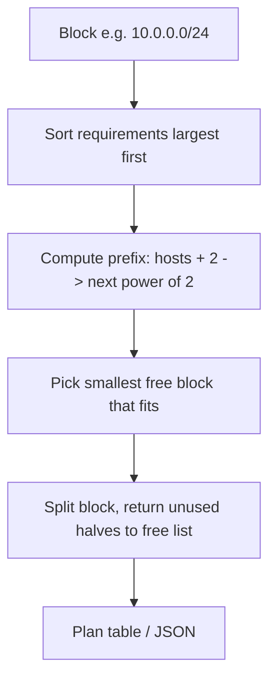

# subnet-calculator

A command-line CIDR calculator and **VLSM planner** built on Python's `ipaddress` module. Give it an address block and the number of hosts each network needs, and it carves the block into non-overlapping subnets.

## Problem
Planning an IP scheme by hand is error-prone: wasted space, overlaps, and miscounted hosts. VLSM (Variable Length Subnet Masking) fits each subnet to its real size.

## How it works


## Setup
```bash
python3 -m venv .venv && source .venv/bin/activate
pip install pytest
pytest
```

## Usage
```bash
python subnetcalc.py info 192.168.1.0/24
python subnetcalc.py plan 10.0.0.0/24 LAN=100 Servers=50 Mgmt=10 Link=2
python subnetcalc.py plan 10.0.0.0/24 LAN=100 Servers=50 --json
```

## Sample output
```
$ python subnetcalc.py plan 10.0.0.0/24 LAN=100 Servers=50 Mgmt=10 Link=2
Name          Need  Subnet             Usable  Host range
LAN            100  10.0.0.0/25           126  10.0.0.1 - 10.0.0.126
Servers         50  10.0.0.128/26          62  10.0.0.129 - 10.0.0.190
Mgmt            10  10.0.0.192/28          14  10.0.0.193 - 10.0.0.206
Link             2  10.0.0.208/30           2  10.0.0.209 - 10.0.0.210
```

## Limitations
- IPv4 only for planning (`info` also accepts IPv6 CIDRs). Smallest subnet allocated is /30.
- Reserves network and broadcast addresses in every subnet; the gateway shown is simply the first usable address.

## What it demonstrates
Networking fundamentals (CIDR, VLSM, address math), clean use of the standard library, input validation, and tests that check no overlaps and sufficient capacity.

## License
MIT
